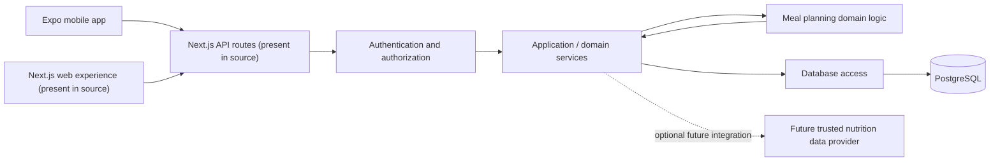
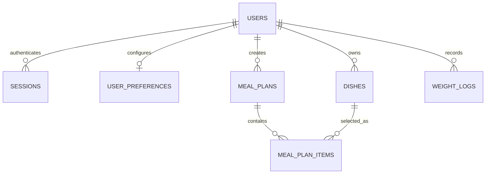
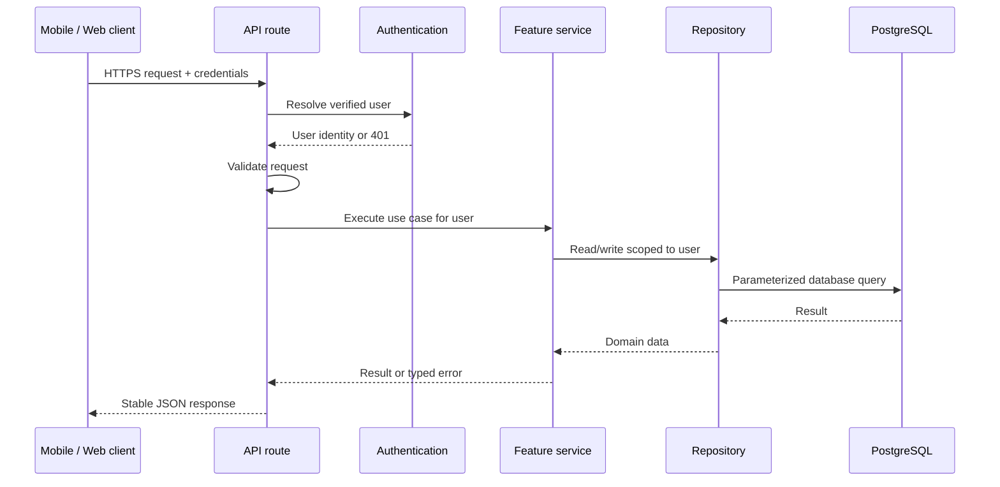

# GlucoPlate Architecture

> **Purpose:** Explain the software as it exists today and outline a practical backend architecture to work toward before implementation begins.
>
> **Audience:** Developers and non-technical stakeholders. Each major area includes a plain-language explanation.
>
> **Status:** Architecture documentation only. The proposed design below is not yet implemented and this document does not authorize code or database changes.
>
> **Review date:** 2026-10-09
>
> **Update:** 2026-10-20 — Session 1 (backend foundation) implemented. See
> §0 below for what this document's findings led to.

---

## 0. Session 1 status: findings from this audit that are now resolved

This document was written as a pre-implementation audit. Session 1 addressed
the structural and identity problems it identified. The rest of the document
is still accurate as a description of the *intended* target architecture.

| Audit finding (§9) | Session 1 outcome |
|---|---|
| **2. Resolve route discovery** — Next.js did not see `src/app_web`; Expo owned the root `app/` | **Fixed.** Expo Router moved to `src/expo-app` (`EXPO_ROUTER_APP_ROOT=src/expo-app`); Next.js now owns `src/app`. All 29 routes build and serve. The `middleware` convention was also migrated to Next 16's `src/proxy.ts`. |
| **3. Choose an authentication contract** — hard-coded mock user, cookie-only, mobile had no token | **Fixed.** Stateless JWT access tokens (`src/lib/jwt.ts`, `jose`/HS256, 7-day expiry). `POST /api/auth/register`, `POST /api/auth/login`, `GET /api/auth/me`, `POST /api/auth/logout`. The web app mirrors the token into an httpOnly cookie; the Expo app sends `Authorization: Bearer`. Passwords hashed with scrypt and compared in constant time. |
| **4. Define a stable HTTP contract** — `apiFetch` returned a `Response` while screens treated it as parsed JSON; the chat client sent `message`/expected `content` | **Fixed.** `apiFetch` returns a `Response`; `apiJson` returns parsed JSON. The chat endpoint now accepts `query` and returns `answer`. `/api/health` reports real database state instead of pretending. |
| **5. Make identity and ownership consistent** | **Partially fixed.** Every protected route resolves the caller through `getCurrentUser()`. Ownership checks remain per-route and still need the repository-boundary treatment described in §6.4. |
| **7. Define plan-history semantics** — editing or deleting a dish rewrote history | **Fixed.** `meal_plan_items` now snapshots `dish_name`, `planned_cost`, `carbs_g`, `calories` and `glycemic_index` at plan time. Analytics read the snapshot. |
| **8. Separate demo mode from normal operation** — GET routes returned another person's sample data | **Fixed.** `/api/plans` returns an empty list for a new account; mock data is only returned when the database itself is unreachable. |
| **9. Reproducible tooling** — no lockfile, NativeWind missing | **Fixed.** The lockfile is tracked, `nativewind` and its Tailwind v4 peer are installed, `drizzle-kit` and `eslint` are installed, and `.npmrc` sets `include=dev` so `NODE_ENV=production` shells do not prune devDependencies. |

### Additions Session 1 made that this document did not anticipate

- **Payments table** — `payments` (M-Pesa STK push fields) added to the schema
  ahead of the Session 5 integration.
- **Diabetes severity ladder** — `users.diabetes_level`
  (`healthy` → `prediabetes` → `type2_controlled` → `type2_high_risk` →
  `critical`) with per-level carbohydrate and glycemic index ceilings, plus
  `needs_clinician_review`.
- **Shared Kenyan dish catalogue** — 42 dishes with `user_id = NULL` are
  visible to every account; user-added dishes are private. This is what lets
  the five personas differ without duplicating data.
- **Budget semantics** — `budget_amount` is the total for `budget_period`;
  the planner's daily allowance is derived from it (`src/lib/budget.ts`).
- **Cost discipline** — currency is KES everywhere.

---

## 1. Executive overview

GlucoPlate is intended to help a person organize dishes, plan meals against a budget and carbohydrate target, save plans, and track selected health information. The repository contains two apparent client experiences:

1. An Expo / React Native mobile application under `app/`.
2. A Next.js web application and API under `src/app_web/`.

Both are intended to share PostgreSQL-backed data and TypeScript logic. Drizzle ORM defines and accesses the database. The shared meal allocator is in `src/lib/planner.ts`.

The intended high-level flow is:



**Important:** This describes the intended system, not a verified working deployment. The current folder layout, authentication behavior, mobile API handling, and demo data need to be reconciled before relying on this architecture in production.

### Plain-language version

The phone app and browser pages are the front doors. The API is the service desk that receives requests, checks who is asking, applies the meal-planning rules, and reads or writes information in PostgreSQL. At the moment, parts of those front doors and the service desk do not appear to agree on where routes live, how users prove who they are, or how responses are formatted.

## 2. What is in the repository today

The project is a **full-stack application with mobile and web-facing code**, rather than a library or command-line tool. It is not currently organized as a formal multi-package monorepo: one root `package.json` mixes Expo and Next.js dependencies and scripts.

The source inventory contains 83 files when excluding `.git`, `.kilo`, `.expo`, `.next`, and `node_modules`:

| Area | Files | Responsibility |
|---|---:|---|
| `app/` | 15 | Expo Router mobile screens and layout |
| `src/` | 53 | Next-style web/API source, shared libraries, and database code |
| `scripts/` | 1 | Demo seeding script |
| Repository root | 14 | Package/configuration, documentation, and generated TypeScript cache files |

The counts describe the checked-out files, not supported runtime routes. For example, the Next.js-looking sources are nested under `src/app_web/`, and the Expo app uses nonstandard filenames with literal trailing backticks for two screens and the Metro config.

### Plain-language version

There is one shared project folder containing the phone app, browser pages, server code, database definitions, and setup files. Keeping everything together can make sharing code easier, but the project needs clearer boundaries so the phone app’s build tools do not confuse themselves with the web app’s build tools.

## 3. Existing architecture in technical terms

### 3.1 Client / presentation layer

#### Expo mobile client: `app/`

Expo Router screens use React Native controls such as `View`, `Text`, and `TouchableOpacity`.

| Feature | Main source |
|---|---|
| App navigation and safe-area provider | `app/_layout.tsx` |
| Initial route and sign-in / registration | `app/index.tsx`, `app/login.tsx` |
| Overview | `app/dashboard/index.tsx` |
| Dish bucket | `app/dashboard/dishes/index.tsx`, `app/dashboard/dishes/_components/DishModal.tsx` |
| Meal planning | `app/dashboard/planner/index.tsx` |
| Saved plans | `app/dashboard/plans/index.tsx` |
| Health hub, weight, and chat | `app/dashboard/health-hub/index.tsx`, `app/dashboard/health-hub/_components/` |
| Analytics | `app/dashboard/analytics/index.tsx` |
| Settings | `app/dashboard/settings/index.tsx` |

``app/dashboard/planner.tsx` `` and ``app/dashboard/health-hub.tsx` `` are also present with literal backticks at the end of their filenames. They appear to be older or alternative screens and call endpoints not found among the current API handlers. They should be assessed as duplicate/legacy candidates before being relied on.

#### Next.js web client: `src/app_web/`

The repository contains server-rendered dashboard pages and client components under `src/app_web/dashboard/`, plus a login view and shared visual components under `src/components/`. This resembles a Next.js App Router application, but the directory name is `app_web`, not the conventional `app` or `src/app`.

The root `app/` is already used for Expo Router. Consequently, the two frameworks currently compete for the usual `app/` route location if both are built from the same package root.

### 3.2 API / request-handling layer

The apparent API route handlers are in `src/app_web/api/`. The inventory is:

| Route in source | Operations | Intended responsibility |
|---|---|---|
| `/api/auth/register` | POST | Create account, seed starter dishes, create session |
| `/api/auth/login` | POST | Verify password and create session |
| `/api/auth/logout` | POST | Delete session and cookie |
| `/api/health` | GET | Database connectivity probe |
| `/api/dishes` | GET, POST | List and create dishes |
| `/api/dishes/[id]` | PATCH, DELETE | Update and delete an owned dish |
| `/api/plans/generate` | POST | Generate an unsaved plan preview |
| `/api/plans` | GET, POST | List saved plans and create a saved plan |
| `/api/plans/[id]` | DELETE | Delete an owned saved plan |
| `/api/plans/update-item` | PATCH | Change a saved meal item's status |
| `/api/settings` | PATCH | Update name, daily budget, or carb target |
| `/api/user/profile` | GET, PATCH | Read/write diabetes preferences |
| `/api/user/budget` | GET, PATCH | Read/write budget-period settings |
| `/api/user/weight-targets` | GET, PATCH | Read/write current and target weights |
| `/api/weight` | GET, POST | List and add weight logs |
| `/api/analytics` | GET | Summarize plan and nutrition history |
| `/api/nutrients` | GET | Return sample nutrient values |
| `/api/chat` | POST | Return a small set of simulated health answers |

Route handlers currently combine HTTP concerns, input conversion/validation, database operations, and some business logic. For a small pilot this is a common starting point, but it makes consistent authorization, validation, transaction handling, and testing harder as features grow.

**Route-discovery caveat:** The files above exist in the repository, but Next.js does not ordinarily discover `src/app_web` as an App Router directory. At the same time, the repository root has Expo Router's `app/`. Confirm the intended build/deployment structure before assuming these route paths are reachable.

### 3.3 Shared logic and types

| File | Current responsibility |
|---|---|
| `src/lib/planner.ts` | Greedy meal selection by slot, plus GI band labels |
| `src/lib/types.ts` | Mobile-facing Dish, Plan, and form TypeScript shapes |
| `src/lib/format.ts` | Display helpers, such as money/date/meal labels |
| `src/lib/mock-data.ts` | Sample user-facing dishes and plans |
| `src/lib/seed.ts` | Starter dish rows inserted for a new user |
| `src/lib/mobile/api-client.ts` | Mobile HTTP wrapper and SecureStore token helpers |
| `src/lib/auth.ts` | Password hashing, session cookie helpers, and current-user lookup |

The shared planner filters dishes by meal slot, avoids repeating a dish in the same generated day, accounts for pantry dishes as zero cost, and sums carbohydrates and calories. It is a greedy per-slot algorithm: it does not search all possible meal combinations for the globally best plan. It calculates whether the final plan meets budget and carbohydrate thresholds and returns a message, but it can still return an over-limit plan when no candidate fits.

There is a documentation mismatch: `README.md` and `CLAUDE.md` state the selection order as GI → cost → carbs, while `src/lib/planner.ts` orders candidates by GI → carbs → cost.

### 3.4 Persistence layer

`src/db/schema.ts` defines the PostgreSQL data model using Drizzle ORM. `src/db/index.ts` creates a `pg` connection pool and exports the Drizzle client.

The database connection uses `DATABASE_URL`. In a non-production environment without that variable, the module warns and falls back to a local placeholder URL. That permits module initialization but does not provide a working database.

There is a Drizzle configuration file, `drizzle.config.json`, whose checked-in database URL is a local development address. Production database access should be supplied through deployment secrets/environment configuration, not source-controlled configuration.

### 3.5 Application configuration and entry points

| File | Observed role |
|---|---|
| `package.json` | One root package; `dev`, `build`, `start`, `lint`, and `typecheck` use Next.js/TypeScript; `main` points to Expo Router |
| `app.json` | Expo application name, identifiers, scheme, and mobile metadata |
| `next.config.ts` | Next configuration; currently empty |
| `tsconfig.json` | Strict TypeScript, Next plugin, `@/*` alias to `src/*`, and Expo base configuration |
| `babel.config.js` | Expo Babel preset and Reanimated plugin |
| ``metro.config.js` `` | Expo Metro configuration, but filename has a trailing backtick |
| `eslint.config.mjs` | ESLint flat config based on Next Core Web Vitals |
| `drizzle.config.json` | Drizzle schema and PostgreSQL development connection |
| `.gitignore` | Ignores `.env*` and `package-lock.json` along with generated folders |
| `scripts/seed-demo.mjs` | Demo seed entry point |

There is no package manager lockfile in the repository, and the documented NativeWind setup is not present in `package.json`'s dependency list. The project configuration therefore does not yet express a fully reproducible Expo + Next environment.

## 4. Existing data model

The following relationships are inferred from Drizzle table definitions and foreign keys in `src/db/schema.ts`.



| Entity/table | Main fields | Relationships and purpose |
|---|---|---|
| `users` | Name, unique email, password hash, daily/period budget settings, currency, payday date, carb target, current/target weight, creation time | Account owner and default preferences. Owns dishes, plans, sessions, weight logs, and one preference row. |
| `sessions` | User ID, token, expiry, creation time | Server-side session records associated with a user. |
| `user_preferences` | User ID, diabetes type, allergies, dislikes | One preference row per user. Allergies and dislikes are currently free-form text strings. |
| `dishes` | User ID, name/description, meal slot, cost, pantry flag, calories, carbs, protein, GI, creation time | User-owned dishes and nutrition/cost inputs for meal planning. |
| `meal_plans` | User ID, date, budget, total cost/carbs/calories, creation time | A saved daily plan summary. |
| `meal_plan_items` | Plan ID, dish ID, slot, status, actual cost | A selected dish associated with a plan and meal slot. |
| `weight_logs` | User ID, weight, date, creation time | Time-series weight entries for tracking. |

The dish and plan tables have user indexes. Foreign keys generally cascade on parent deletion. In particular, deleting a dish can cascade to plan items that reference it, which can remove the dish from historical plans.

### Plain-language version

The database keeps account details, saved food choices, meal plans, the foods in each plan, user preferences, and weight entries. A person owns their own food list and plans. A plan contains multiple meal slots, and each slot points to one saved dish.

## 5. Current behavior and important caveats

These are observations from the checked-in code, not claims that the app has been tested in a deployed environment.

### Authentication and privacy

- Passwords are hashed with Node's `scrypt`, and password comparisons use a timing-safe comparison in `src/lib/auth.ts`.
- Web authentication creates an HttpOnly cookie and a matching database session.
- `getSession()` reads the session and user but does not reject database sessions based on `expiresAt`.
- `getCurrentUser()` currently returns a hard-coded mock user rather than verifying a session.
- Mobile sign-in attempts to store a returned bearer token, but the login and registration routes currently return `{ ok: true }` and set a cookie instead.
- Many handlers call `getCurrentUser()`, while some profile and budget handlers call `getSession()`. This creates inconsistent identity behavior.
- `mealPlans/update-item` updates by item ID without checking that its plan belongs to the authenticated user.
- No rate-limiting or account lockout behavior is visible in the inspected route code. Cookie-based mutation protection/origin checks should be explicitly designed.

**Meaning:** The security building blocks are partly present, but the active identity and ownership rules are not consistently enforced. Do not use real personal or health data until that is corrected and tested.

### API and client contract

- `apiFetch()` returns a raw browser-style `Response`.
- Several mobile screens treat the return value as already-parsed JSON.
- Other screens explicitly call `.json()`, confirming the client convention is inconsistent.
- The chat client sends a `message` field and looks for `content`; the current chat endpoint expects `query` and returns `answer`.
- A mobile screen requests chat history and other health/planner endpoints that are not present in the current API route inventory.
- Fetching a response is not the same as a successful request: callers need a consistent way to detect HTTP errors.

**Meaning:** The app screens and server endpoints need a shared, documented agreement on request and response formats.

### Demo data and health content

- Dish and saved-plan GET routes can return sample data when the database has no rows or when a database error occurs.
- The nutrient endpoint is a fixed sample lookup and returns a generic estimate for unknown ingredients.
- The chat endpoint is a small phrase-matching demo and explicitly describes its source as simulated.
- Starter dishes are inserted at account registration.

**Meaning:** Users need to be able to tell demo content from their own saved content. Nutrition and health guidance must not be represented as medically verified unless it is based on qualified, traceable sources and reviewed for the intended use.

### Meal-plan behavior and records

- Planner output marks whether budget and carbohydrate totals are within the submitted limits, but can still return a plan that exceeds a limit.
- The planner's actual candidate order differs from its documentation.
- Saved plan item status updates are not wrapped with the plan-cost recalculation in an explicit transaction.
- The status-update cost query sums dish cost and may not follow the pantry-as-zero-cost rule used during plan generation.
- Historical plan details refer to live dish records, so deleting a dish can remove history.

**Meaning:** A plan may need clear “not within target” messaging, and old saved plans should remain understandable even if the user later changes or deletes a dish.

## 6. Proposed backend architecture (rough design, not implemented)

### 6.1 Recommended shape: a modular monolith

Start with **one backend application divided into clear feature modules**, rather than separate microservices. The current scope—accounts, dishes, plans, weight history, and analytics—does not require independent services yet. A modular monolith is easier to build and operate while still making responsibilities and boundaries clear.

The Expo mobile client should call the backend over HTTPS. If the browser-based Next.js experience is still a product requirement, keep it as a distinct web client that calls the same API; do not mix its routes with Expo Router's `app/` tree. Shared types/contracts and planner rules can live in packages imported by the relevant apps.

One possible future structure:

```text
apps/
  mobile/                         Expo / React Native client
    app/
    src/
      features/
      services/api-client.ts
  api/                            Next.js backend application
    src/
      app/api/v1/                 Thin HTTP route handlers
      server/
        auth/                     Login, registration, session resolution
        modules/
          users/
          preferences/
          dishes/
          nutrition/
          planning/
          weight/
          analytics/
        shared/
          errors/
          validation/
          logging/
          database/
  web/                            Optional browser client, if retained
    app/
    src/
      features/
packages/
  contracts/                      Shared request/response schemas and types
  domain/                          Pure planner and domain rules
  database/                        Drizzle schema, migrations, connection, repositories
```

This is a starting proposal, not a mandate to create every folder immediately. If keeping a single repository and one Next.js deployment is preferred, the same logical boundaries can be created inside one app without splitting into separate packages at first.

### Plain-language version

Keep one server for now, but organize its work into labeled departments: accounts, food lists, meal planning, health tracking, and reporting. The mobile app and any browser app become separate front ends that use the same server. That avoids building and maintaining many tiny servers before the product needs them.

### 6.2 Backend request flow

Every API request should follow the same sequence:

1. **Receive request** — route handler reads path, method, headers, and body.
2. **Identify caller** — resolve a valid user from a session or mobile credential; reject unauthenticated requests where required.
3. **Validate input** — parse and validate the body/query/path using shared schemas; reject invalid numbers, dates, enum values, and oversized input.
4. **Call a feature service** — service applies use-case rules, such as registering a user, adding a dish, generating a plan, or logging weight.
5. **Read/write through repositories** — repositories perform database operations and enforce user ownership in query conditions.
6. **Use a transaction when needed** — related changes, such as saving a plan plus its items or changing an item plus recalculating totals, succeed or fail together.
7. **Return a stable response** — use one documented success/error format; never disguise a database failure as successful sample data.
8. **Log safe diagnostics** — include request/correlation ID and error details for operators, but never log passwords, raw session tokens, or unnecessary health data.



### 6.3 Proposed feature modules

| Backend module | Owns | Example use cases |
|---|---|---|
| `auth` | Credential verification, registration, logout, session/token lifecycle, current-user resolution | Register, sign in, sign out, refresh or renew a session |
| `users` | User account profile and account lifecycle | Read/update name and account settings |
| `preferences` | Diabetes type, allergies, dislikes, and preference validation | Read/update food preferences |
| `dishes` | User-owned dishes and dish validation | List, create, update, delete dishes |
| `nutrition` | Nutrient lookup provider boundary, source metadata, safety labeling | Look up a food only through a vetted provider; return source and confidence/availability metadata |
| `planning` | Meal-plan generation, save/read/delete plans, plan-item status changes | Preview plan, save plan with items, mark eaten/skipped, retrieve history |
| `weight` | Weight targets and history | Read target, record a measurement, list measurements |
| `analytics` | Read-only calculations over saved plans and logs | Plan counts, spending totals, carbohydrate trends |
| `shared` | Cross-cutting validation, errors, logging, database setup, pagination | Standard request parsing and error responses |

Each module can follow this internal pattern where useful:

```text
modules/<feature>/
  <feature>.routes.ts       HTTP boundary; parse input and map errors
  <feature>.schema.ts       Request/response validation contracts
  <feature>.service.ts      Use-case orchestration and business rules
  <feature>.repository.ts   Database reads/writes scoped to user
  <feature>.types.ts        Feature-specific domain types
```

Do not create empty layers solely to follow a template. A thin feature can begin with a route, service, and repository only when responsibilities are genuinely distinct.

### 6.4 Proposed database ownership and transaction boundaries

Keep PostgreSQL as the source of truth. Keep Drizzle as the typed database access layer, with schema changes represented by reviewed migrations rather than relying on an ad hoc production schema push.

Repositories should require a user ID for user-owned data. Queries should combine the resource identifier and `userId`/owned parent condition so authorization is enforced at the data boundary—not only in the screen or route. For a plan item, ownership should be established through its parent meal plan.

Use a database transaction for at least:

- Creating an account and its initial preferences/dishes, if the product retains registration-time seeding.
- Saving a meal plan and all of its plan items.
- Updating a plan item and any derived plan totals.
- Deleting data whose related records must be handled consistently.

The current schema can be used as the initial model, but before implementation the team should decide whether to preserve historical meal data independently of live dish rows, how to represent money precisely, and whether values like meal status and meal slot need database-level constraints. These are design decisions, not changes included in this document.

### 6.5 Proposed authentication model

Authentication needs one explicit contract shared by mobile, web, and API:

- The backend is the authority for identity. A user ID supplied by the client is never trusted as proof of ownership.
- Every request to protected routes resolves a verified, non-expired session or credential.
- Web can use a Secure, HttpOnly, SameSite cookie. Cookie-authenticated state-changing requests should have CSRF/origin protections.
- Mobile needs an explicit credential plan compatible with SecureStore. One option is an opaque, revocable bearer token with rotation/expiry; another is a properly supported cookie session. Choose one deliberately and implement the same contract in login, API middleware, and logout.
- Store only a hash of long-lived opaque tokens in the database where practical, and make logout/revocation invalidate server-side state.
- Apply per-user ownership checks to every operation involving dishes, plans, preferences, and weight data.
- Add request throttling for login/registration and carefully limit authentication error detail.
- Never use the current hard-coded mock user outside a clearly isolated local/demo mode.

**Plain-language version:** Each person must have their own working key. The server checks that key on every private request and checks that the requested record belongs to that person. A sample/demo account must not become the identity for all visitors.

### 6.6 Proposed API contract conventions

Keep API paths versioned (for example `/api/v1/...`) once clients depend on them. Give mobile and web the same JSON contracts. Establish and document:

- Whether the client helper returns parsed JSON or a raw `Response`—not both patterns.
- A common error shape, for example `{ "error": { "code": "...", "message": "..." } }`.
- Stable resource response shapes, such as `{ "data": ..., "meta": ... }` where pagination is used.
- Standard status codes for validation, authentication, authorization, not-found, conflict, and server errors.
- Request/response schemas shared or generated from one source where practical.
- Pagination and sorting behavior for growing dish, plan, and weight histories.

Possible route organization:

| Resource | Example endpoints |
|---|---|
| Authentication | `POST /api/v1/auth/register`, `POST /api/v1/auth/login`, `POST /api/v1/auth/logout`, optional session refresh |
| Current user/preferences | `GET/PATCH /api/v1/me`, `GET/PATCH /api/v1/me/preferences`, `GET/PATCH /api/v1/me/budget` |
| Dishes | `GET/POST /api/v1/dishes`, `GET/PATCH/DELETE /api/v1/dishes/:dishId` |
| Meal plans | `POST /api/v1/plans/preview`, `GET/POST /api/v1/plans`, `GET/DELETE /api/v1/plans/:planId` |
| Plan items | `PATCH /api/v1/plans/:planId/items/:itemId` |
| Weight | `GET/POST /api/v1/me/weight-logs`, `GET/PATCH /api/v1/me/weight-targets` |
| Analytics | `GET /api/v1/me/analytics` |
| Nutrition | `GET /api/v1/nutrition/lookup?query=...` |
| Health check | `GET /api/health` (operational health only; do not leak secrets or internals) |

The current routes are not all organized this way; this table is a suggested future contract.

### 6.7 Meal planner boundary

Treat meal generation as domain logic, not UI logic:

```text
Plan request + user limits + user-owned dishes
                    |
                    v
          Planning service validates inputs
                    |
                    v
         Pure planner selects candidates
                    |
                    v
      Result includes totals and constraint status
                    |
           preview only / save transaction
```

The service should:

- Define the intended ranking and tie-breaking order in one source of truth.
- Respect dish eligibility, meal slot, pantry cost, budget, carbohydrate target, allergies, and dislikes according to product decisions.
- Clearly distinguish “a plan was generated” from “the plan meets all targets.”
- Return why the plan is infeasible when constraints cannot all be met.
- Save a historical snapshot of the relevant dish values or otherwise define how a past plan behaves when the dish changes.
- Be testable as a pure function with known inputs and outputs, without a database or mobile UI.

Allergy filtering and other safety requirements must not be inferred casually from free-form text. The product needs an explicit rule for what happens when an allergy is present and data is incomplete.

### 6.8 Nutrition and health guidance boundary

The backend should not treat a generic mock value as an authoritative nutrition fact. If nutrition lookup is retained:

- Integrate a selected, licensed and maintained data source through a provider adapter.
- Return source, retrieval time, serving basis, units, and any limitations alongside the values.
- Validate the user’s food/serving selection before applying returned values.
- Do not claim that a generated meal plan is medically approved or will keep blood sugar stable.
- Keep health advice out of unsupported free-form model responses unless a medically reviewed safety design and source policy are established.
- Show an appropriate product disclaimer and escalation guidance in the user experience.

**Plain-language version:** A guessed number for carbohydrates can affect the usefulness of a meal plan. The app should either use a known source and show where the value came from, or tell the user that it does not know.

## 7. Security, privacy, and operational design goals

The following are design goals for future implementation, not claims that the current application already meets them.

### Security and privacy

- Enforce authentication and per-user authorization on every protected route.
- Validate and bound all request bodies, strings, numeric values, dates, and list sizes.
- Keep database credentials and provider keys in a secret manager/environment configuration; do not commit them.
- Use parameterized Drizzle queries and avoid returning password hashes, tokens, or unnecessary fields.
- Use TLS for all production client-to-server and server-to-database traffic.
- Protect cookie-authenticated mutations from CSRF and review CORS rules for mobile/web origins.
- Rate-limit account creation, login attempts, and expensive lookups.
- Define a privacy policy, data retention/deletion process, account deletion behavior, backups, and incident response before collecting real health data.
- Minimize health information collected and logged. Restrict operator access and define backup access.
- Review applicable health and privacy obligations with qualified counsel/compliance personnel before marketing or deploying as a health product.

### Reliability and operations

- Make database availability and API readiness observable through health checks that do not expose internal errors.
- Use structured logs with request IDs and redact personal/health information.
- Alert on authentication failures, database connection issues, elevated server errors, and failed background work.
- Use migrations and backups; test restore procedures.
- Set timeouts and connection-pool limits appropriate to the deployment platform.
- Return honest errors on database/provider failure; demo data belongs behind an explicit demo mode.
- Add integration tests for route authorization and transactions and unit tests for planner rules.

### Plain-language version

Protect the customer’s account and health information, keep passwords and keys out of the code, record enough safe operational information to diagnose outages, and regularly test that backups can be restored. If the database is unavailable, tell the user there is a problem rather than showing invented sample records.

## 8. Strengths to preserve

- The product separates mobile presentation from shared planning logic conceptually.
- The planner is a standalone function and can be tested independently.
- The database already models the central concepts: users, preferences, dishes, plans, plan items, and weight logs.
- Password hashing uses `scrypt`, and the web cookie is configured as HttpOnly and Secure in production.
- Some dish and plan operations already filter by owner. That pattern should be applied consistently everywhere.
- The UI includes medical disclaimers and makes the meal planner’s cost and carbohydrate targets visible.

## 9. Known architecture gaps to resolve before backend implementation

1. **Choose app boundaries.** Confirm whether the product needs both Expo mobile and a browser-based Next.js client. Decide whether Next.js owns only the API or also the web pages.
2. **Resolve route discovery.** Place/configure the Expo app, web app, and Next API so their framework conventions do not collide. Confirm that the intended route handlers are actually served.
3. **Choose an authentication contract.** Decide cookie sessions, mobile bearer sessions, or a deliberate dual-client approach; document token issuance, renewal, expiry, logout, and CSRF behavior.
4. **Define a stable HTTP contract.** Agree on JSON parsing, error format, naming, validation, route versioning, and client behavior for non-success responses.
5. **Make identity and ownership consistent.** Replace the mock current user and require ownership checks at the repository/data-access boundary.
6. **Define data and health safety rules.** Select whether this is a general planning aid or a product providing medical/nutrition guidance, and define what sources and claims are acceptable.
7. **Define plan-history semantics.** Decide whether plan items snapshot dish data and how deleting or editing a dish affects saved plans and analytics.
8. **Separate demo mode from normal operation.** Make sample users, dishes, and plans explicit and ensure they cannot be returned as if they were persisted customer data.
9. **Establish reproducible project tooling.** Choose package manager/workspace strategy, commit its lockfile, and make Expo, Next, lint, typecheck, and tests run against the correct app boundaries.

## 10. Suggested implementation sequence (planning only)

This is an order of work, not a request to begin code changes:

1. Confirm product scope and application topology (mobile only, mobile + web, or other).
2. Write down authentication and API request/response contracts.
3. Map existing screens to API operations and remove/retire obsolete duplicate routes intentionally.
4. Establish the backend module boundaries and database migration workflow.
5. Implement and test authenticated identity resolution and owner-scoped data access before connecting real user data.
6. Unify API client parsing and error handling; connect one vertical slice end-to-end (for example, sign-in → list dishes → add dish).
7. Connect planning preview and saving with transaction and ownership tests.
8. Connect weight/preferences/analytics after access and persistence patterns are established.
9. Replace or explicitly disable simulated nutrition/chat behavior before presenting it as real health guidance.
10. Add production operations, privacy review, deployment configuration, and a tested backup/restore procedure.

### Plain-language version

First decide what products are actually being built and how sign-in should work. Then make one complete feature work safely from phone to server to database. Once that pattern is proven, use it for the other features. Health and nutrition guidance should be handled only after trustworthy data and safety expectations are agreed.

## 11. Working vocabulary

| Term | Plain-language meaning |
|---|---|
| Client / frontend | The screen the person uses on a phone or in a browser |
| API | The agreed way the app asks the server to do something |
| Route handler | The server code that receives one kind of API request |
| Service / use case | The server-side steps for a product action, such as saving a meal plan |
| Repository | The part of the backend that reads and writes database records |
| Domain logic | Product rules that should work independently of screens or database code |
| Authentication | Checking who is making a request |
| Authorization / ownership | Checking whether that person is allowed to access that specific record |
| Transaction | A group of database changes that all succeed together or all roll back |
| Modular monolith | One backend application organized into feature areas rather than many separately deployed services |
| Migration | A reviewed, repeatable database change that can be applied to environments |
| Demo data | Example content used for demonstrations and tests, not a customer’s saved information |
